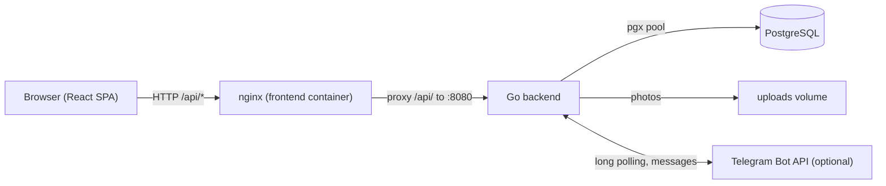

# Architecture

How the Seller Panel backend is built and the rules every feature follows. Business rules live in [`DOMAIN.md`](../../docs/DOMAIN.md), stack choices in [`DECISIONS.md`](../../docs/DECISIONS.md). The frontend rules are in [`frontend/AGENTS.md`](../../frontend/AGENTS.md).

## 1. System overview



- One backend, one database, one SPA. No message queue, no cache, no microservices: the team has 3–5 days.
- The browser only talks to the SPA origin. nginx (production) and the Vite dev server proxy `/api` to the backend, so there is no CORS setup.
- The backend runs as one instance. Data is in PostgreSQL and the uploads volume; open order streams, rate limit counters, the alert queue and the bot polling live in its memory (D18, D21).

## 2. Backend structure

Packages are grouped by **feature**, not by technical layer, so one person can own the backend of a feature.

```
backend/
  cmd/
    server/main.go        process start: config, db, migrations, graceful shutdown
    seed/main.go          dev seed command: refuses outside APP_ENV=development, runs internal/seed (D11)
  migrations/             NNNN_name.up.sql / NNNN_name.down.sql (golang-migrate)
  internal/
    config/               env loading
    app/                  wiring: builds every service, handler, limiter and the router
    database/             pgx pool, DBTX, InTx helper, migration runner
    httpx/                JSON helpers, error type, request logging
    httpapi/              routes and the protected(...) wrapper
    apispec/              serves api/openapi.yaml as JSON (D9)
    auth/                 sign up, login, JWT
    shop/                 shop profile
    catalog/              categories (read only)
    product/              products, photos
    stock/                stock change; reserve / release / commit for orders (D5)
    order/                orders, status machine, simulate order
    dashboard/            summary queries
    seed/                 demo shop, 15 products and 30 orders, written through the services (D11)
    balance/              balance entries
    upload/               images: checked, converted to WebP and stored (D12)
    realtime/             in-process hub and the order event stream (D18)
    telegram/             Telegram Bot API client (D21)
    orderalert/           Telegram message for each new order (D19)
```

Each feature package has the same files. `app`, `httpapi`, `httpx`, `config`, `database`, `apispec`, `realtime`, `telegram` and `seed` are infrastructure or tools and have their own shape:

| File | Responsibility |
|------|----------------|
| `handler.go` | HTTP only: parse request, call service, map errors to status codes |
| `service.go` | Business rules: validation, status machine, stock, commission |
| `repository.go` | The `Repository` interface (declared by the feature) |
| `pgrepository.go` | `PgRepository`, the PostgreSQL implementation: SQL and mapping, no business decisions |
| `errors.go` | The feature's sentinel errors (`ErrNotFound`, `ErrValidation`, ...) |
| `model.go` | Types used by the feature |
| `memrepository_test.go` | `memRepository`, the in-memory fake used by service tests, never in production code |

Authentication helpers live in `auth`: `RequireAuth` for routes, `MustPrincipal` in handlers (answers 401 itself when the principal is missing).

### Layer rules

1. `handler` calls `service`. `service` calls `repository`. Never the other way and never skipping a layer.
2. `service` does not import `net/http`. `repository` does not know about HTTP or rules.
3. `service` declares the repository interface it needs. Tests pass a fake.
4. Features do not import each other's concrete types. If `order` needs stock operations, it declares a small interface and `stock`'s repository implements it.
5. Wiring happens only in `internal/app`, so `cmd/server` and the end-to-end tests run the same application.

## 3. Database access

- Driver: **pgx** (`pgxpool`) with **hand-written SQL**. No ORM, no query generator.
- Repositories take `database.DBTX` (satisfied by both the pool and a transaction), so the same method works inside or outside a transaction. Repositories that need to open a transaction themselves (auth sign up) take the pool and call `database.InTx`.
- `database.InTx(ctx, func(tx pgx.Tx) error)` starts a transaction, commits on `nil`, rolls back on error or panic. Services use it for anything that changes more than one row.
- IDs: `bigint generated always as identity`. Money: `bigint` in so'm. Time: `timestamptz`, stored in UTC.
- Migrations: **golang-migrate**, SQL files in `backend/migrations`, embedded into the binary and applied on backend start (guarded by an advisory lock so two instances cannot race). Never edit a migration that is merged; add a new one.

### Concurrency rules (the part reviewers will check)

- **Reserve stock** is one atomic statement that cannot oversell:
  `UPDATE products SET reserved = reserved + $qty WHERE id = $id AND shop_id = $shop AND stock - reserved >= $qty`. Zero rows updated means `insufficient_stock`.
- **Status change** locks the order row (`SELECT ... FOR UPDATE`), checks the transition table in the service, applies the side effects, and updates the status in the same transaction. Two simultaneous accepts cannot both succeed.
- Orders with several items lock and update products in ascending `id` order to avoid deadlocks.
- The database is the last line of defence: `CHECK` constraints keep `stock >= 0`, `reserved >= 0` and `reserved <= stock`, and status is an enum. A service bug fails loudly instead of corrupting data.

## 4. Auth and data isolation

- Email + password. Passwords hashed with bcrypt. Login returns a JWT (HS256, signed with `JWT_SECRET`, TTL from config) carrying `seller_id` and `shop_id`. A seller who linked a Telegram chat can also sign in with a one-time code (D21).
- An auth middleware validates the token and puts `seller_id` and `shop_id` into the request context. Handlers read them from the context, **never from the request body or URL**.
- **Every repository method takes `shopID` and includes it in the `WHERE` clause.** Asking for another seller's product or order returns `404`, same as a missing one. This is the single rule that guarantees "a seller only sees their own data" and it gets a test per feature.
- Logout is client-side (drop the token). No server session store.

## 5. API conventions

The contract is `api/openapi.yaml` (D3). These conventions apply to every endpoint:

| Topic | Rule |
|-------|------|
| Format | JSON, `snake_case` fields, money as integer so'm |
| Lists | `?page=1&page_size=20` (default 20, max 100). Response: `{ "items": [...], "page": 1, "page_size": 20, "total": 134 }` |
| Errors | `{ "code": "insufficient_stock", "message": "..." }`, the shape of `httpx.Error`. The validation message says which field is wrong |
| `400` | Invalid JSON (`code: invalid_body`) or invalid input (`code: validation_error`) |
| `401` | Missing or invalid token |
| `404` | Not found, or belongs to another shop |
| `413`, `415` | Uploads only: `file_too_large`, `unsupported_media_type` |
| `503` | `busy` (with `Retry-After`): too many images being processed, or too many requests in progress (D22) |
| Unknown route, wrong method | JSON too: `404 not_found` and `405 method_not_allowed` with an `Allow` header (`httpx.JSONErrors` wraps the router) |
| Empty values | Follow the column: a nullable column that is not set is `null` (`logo_url`, `contact_phone`, `pickup_address`), a `NOT NULL DEFAULT ''` text is `""` (product `description`). Lists are `[]`, never `null` |
| Times | UTC in RFC 3339 (`2026-11-24T07:56:00Z`). Repositories call `.UTC()` when they scan a `timestamptz` |
| `409` | State conflict: invalid status transition, insufficient stock, duplicate SKU, email taken |
| `500` | Unexpected. Logged with details, response has no internals |
| Validation | In the service, before any SQL. The database constraints are a second check, not the first |

Known shape differences, on purpose: `GET /categories` returns `{"items": [...]}` without paging fields (about a dozen rows), `GET /health` returns `{"status": "ok"}`, or `503 database_unavailable` when the database does not answer within 2 seconds (D23). Every endpoint that answers with a product (list items, create, get, update, archive, stock change) answers with the same fields (D14).

Images: a product is saved with its photos and the shop with its logo in one request (`POST /products`, `PUT /products/{id}` and `PUT /shop` as `multipart/form-data`; 1 to 5 photos, or one logo, of jpeg, png or webp, 5 MB each), converted to WebP and stored as `UPLOAD_DIR/<shop_id>/<random>.webp`; the responses have `photos` and `logo_url` with their URLs. nginx serves the files itself, read only from the same volume, at `GET /api/uploads/{shop_id}/{name}` (public, no backend call). See D12, D15 and D16.

## 6. Cross-cutting

- **Config:** environment variables only, loaded once in `config`. Defaults make `docker compose up` work without a `.env`.
- **Logging:** `log/slog` JSON to stdout, one line per request (method, path, status, duration), no passwords or tokens.
- **Rate limiting:** nginx limits per IP, the backend limits per shop on protected routes and guards login against password guessing, see D6. Every protected route goes through `protected(...)` in `httpapi/router.go`, so a new route is limited without extra code.
- **Shutdown:** `http.Server.Shutdown` on SIGTERM, then close the pool.
- **Time zone:** "today", "last 7 days" and "last 30 days" on the dashboard use one fixed business time zone, `BUSINESS_TIMEZONE`, default `Asia/Tashkent` (see D10).

## 7. Testing strategy

| What | How | Where |
|------|-----|-------|
| Status transitions | Table-driven unit tests over every `from → to` pair, valid and invalid | `order` service |
| Commission math | Pure function with integer arithmetic, edge cases (rounding, zero) | `balance` / `order` service |
| Stock reserve and release | Integration tests against a real PostgreSQL, including two concurrent accepts and "never negative" | `stock` + `order` repository |
| Data isolation | Per feature: seller B requesting seller A's resource gets `404` | handler or integration |
| HTTP behaviour | `httptest` against the router | each `handler` |
| Whole journeys, isolation, error shape, limits | Real router and PostgreSQL through `app.NewHandler`, build tag `e2e` | `backend/e2e` |

CI (`.github/workflows/ci.yml`) runs formatting, vet, the linter, tests against a PostgreSQL service with a coverage minimum, the end-to-end tests, a vulnerability check, the frontend lint and build, and a smoke test of the Docker stack.

## 8. Answered questions

Open while the design was a draft. The numbers are kept because `DECISIONS.md` refers to them.

1. **Token storage.** `localStorage` with `Authorization: Bearer`, a known trade-off against XSS (D2).
2. **Integration test database.** A `postgres` service in CI and a throwaway `_test` database locally.
3. **Business time zone.** `Asia/Tashkent` by default, set with `BUSINESS_TIMEZONE` (D10).
4. **Order number.** One global sequence starting at 100000 (`#100245`).
5. **Photos.** A local volume served by nginx, object storage is out of scope (D12).
