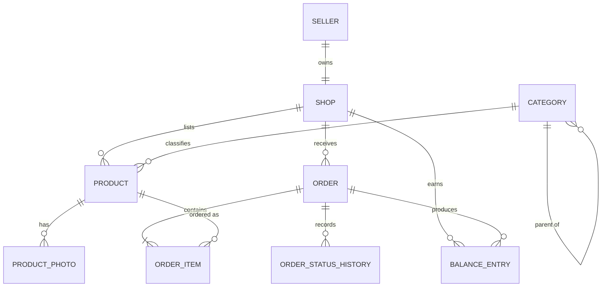

# Data model and schema

Entities, relations, constraints and the rules that keep stock and money correct. Starts from the suggested model in [`DOMAIN.md`](../../docs/DOMAIN.md); every change from it is listed in section 8. Conventions and layers are in [`ARCHITECTURE.md`](../../docs/ARCHITECTURE.md).

**Source of truth:** the SQL files in `backend/migrations`. This document and [`schema.dbml`](schema.dbml) explain them and show the target schema. When they disagree, the migration wins and the docs get fixed. A merged migration is never edited, a change is a new migration.

**Diagram:** paste [`schema.dbml`](schema.dbml) into [dbdiagram.io](https://dbdiagram.io/d). It lists every table, constraint and relation. DBML cannot express the partial index on delivered orders, DESC index columns and the trigram indexes, noted at the top of that file.

## 1. Entity relationship diagram



Ownership rule: everything a seller can see hangs off exactly one `shop_id`, and every query is scoped by it. There is no buyer entity, the buyer's name, phone and address are stored on the order.

## 2. Conventions

- IDs: `bigint GENERATED ALWAYS AS IDENTITY`. Money: `bigint` in so'm, never floats. Time: `timestamptz`.
- Status columns are PostgreSQL enums, so a typo cannot be stored.
- Rules that must never break are `CHECK` or `UNIQUE` constraints, not only checks in Go. The service validates first and returns a friendly error, the database is the last line of defence.
- Nothing is deleted in normal operation: products are archived, orders are cancelled, balance entries are append only. The only cascade is `product_photos` when a product is removed.

## 3. Tables

### sellers
`id`, `email` (unique, lower-case), `password_hash` (bcrypt), `created_at`.

### shops (exactly one per seller)
`id`, `seller_id` (unique), `name` (required), `logo_url`, `description`, `contact_phone`, `pickup_address`, `created_at`. An empty shop is created together with the seller at sign up, so every authenticated seller has a `shop_id`.

### categories (seeded, read only)
`id`, `name`, `parent_id` (nullable, two levels are enough). Unique per `(COALESCE(parent_id, 0), name)`.

### products
`id`, `shop_id`, `category_id`, `title`, `description`, `price`, `sku`, `stock`, `reserved`, `status` (`draft`, `active`, `archived`), `created_at`, `updated_at`.

Derived, not stored: `available = stock - reserved`, and the stock label: `out_of_stock` when `available = 0`, `low_stock` when `available <= LOW_STOCK_THRESHOLD`, `in_stock` otherwise.

### product_photos
`id`, `product_id`, `url`, `position` (0 is the cover). A table rather than an array so order and removal are simple.

### orders
`id`, `shop_id`, `number` (sequence from 100000, shown as `#100245`), `status`, `buyer_name`, `buyer_phone`, `delivery_address`, `total` (fixed at creation), `cancel_reason`, `created_at`, `status_changed_at`. One order belongs to one shop.

### order_items
`id`, `order_id`, `product_id`, `title_snapshot`, `price_snapshot`, `quantity`. Title and price are copied at order time, so editing or archiving a product never changes old orders.

### order_status_history
`id`, `order_id`, `from_status`, `to_status`, `reason`, `created_at`. One row per transition, written in the same transaction as the status change. Powers the order timeline.

### balance_entries
`id`, `shop_id`, `order_id` (null for payouts), `type` (`sale`, `commission`, `payout`), `amount` (signed), `created_at`. Append only. Balance is the sum of `amount` per shop.

## 4. Which constraint protects which rule

| Rule | Enforced by |
|------|-------------|
| Stock never negative, reserved never negative or above stock | `stock >= 0`, `reserved >= 0`, `products_reserved_within_stock` |
| SKU unique per shop | `products_shop_sku_key` on `(shop_id, sku)` |
| One shop per seller, unique lower-case email | `shops.seller_id` unique, `sellers.email` check and unique |
| Price and quantity positive, money is an integer | `CHECK (price > 0)`, `CHECK (quantity > 0)`, `bigint` columns |
| Cancel reason required exactly when cancelled | `orders_cancel_reason_matches_status` |
| Only known statuses | enums |
| A product appears once per order | `order_items_order_product_key` |
| One `sale` and one `commission` entry per order, so a second delivery cannot double-count | `balance_entries_order_type_key` |
| Balance signs are right, payouts have no order | `balance_entries_sign`, `balance_entries_order_matches_type` |
| Order numbers unique and human readable | `order_number_seq`, `number` unique |
| Photo positions do not collide | `product_photos_position_key` (deferrable, so reordering inside one transaction works) |

## 5. Indexes

| Index | Serves |
|-------|--------|
| `products_shop_status_created_idx` | product list filtered by status, newest first |
| `products_shop_category_idx` | filter by category |
| `products_title_trgm_idx`, `products_sku_trgm_idx` | `ILIKE '%text%'` search (`pg_trgm`) |
| `orders_shop_status_created_idx` | order list by status, waiting-for-action counts |
| `orders_shop_created_idx` | all orders newest first, today's orders |
| `orders_shop_delivered_idx` (partial) | revenue and top products for delivered orders in a date range |
| `order_items_product_idx` | top products, product lookups |
| `balance_entries_shop_created_idx` | balance history |
| `order_status_history_order_idx` | order timeline |

## 6. Migrations

Each feature owner writes the migration for the tables they own, in the order the features merge (`TEAM.md`).

| Migration | Tables | Owner | Status |
|-----------|--------|-------|--------|
| `0001_sellers_shops` | `sellers`, `shops` | Auth, Shop profile | merged |
| `0002_categories` | `categories` and the seeded tree, read through `GET /categories` (#72) | Products | merged |
| `0003_products` | `products` and its enum, constraints, indexes and the `pg_trgm` extension | Products (#46) | merged |
| product photos | `product_photos` | Products | planned |
| `0004_balance_entries` | `balance_entries` and its enum, constraints and index, without the foreign key to `orders` (that table did not exist yet) | Balance (#84) | merged |
| `0005_orders` | `orders`, `order_items`, `order_status_history`, `order_number_seq`, and the foreign key `balance_entries.order_id` to `orders` | schema by Balance (#91), Go code by Orders (#70) | merged, written by the order code in this PR |

Reference data (categories) ships as a migration. Demo data (seller, shop, about 15 products, about 30 orders with balance entries) comes from a seed command that only runs when asked and writes through the service code, so the numbers stay consistent.

## 7. Money, stock and status rules

**Stock.** `available = stock - reserved` is the only number a buyer or the simulate-order endpoint may use. Reserving is all or nothing per order. A manual stock change sets the new `stock`, which must be `>= reserved`. Archiving keeps `reserved` units until those orders finish.

Reserve when an order is accepted, run per item inside the transaction with items ordered by `product_id`. Zero rows updated means `409 insufficient_stock` and the transaction rolls back, so two simultaneous accepts cannot oversell:

```sql
UPDATE products
SET reserved = reserved + $qty, updated_at = now()
WHERE id = $product_id AND shop_id = $shop_id AND stock - reserved >= $qty;
```

**Status machine.** Allowed transitions and their side effects are in [`DOMAIN.md`](../../docs/DOMAIN.md). Every transition runs in one transaction: lock the order with `SELECT ... FOR UPDATE`, validate in the service, update the order, write one history row. `accepted` reserves, `cancelled` releases, `delivered` commits stock and writes the balance entries. Any other transition is rejected with `409 invalid_transition`.

**Money.** `commission = total * COMMISSION_PERCENT / 100`, integer division, config default 10. A `sale` entry of `+total` and a `commission` entry of `-commission` are written once, when the order becomes `delivered`. Cancelled orders create no entries. Example: `total 12345` gives commission `1234` and net `11111`; the entries sum to exactly `11111`, no so'm is lost or invented.

**Dashboard.** Dates use the business time zone from `ARCHITECTURE.md`. Today's orders: `created_at` today. Waiting for action: orders in `new`, `accepted` or `packed`. Revenue 7 and 30 days: sum of `total` of orders that became `delivered` in the window, by `status_changed_at`. Top 5 products: units sold in orders delivered in the last 30 days.

## 8. Differences from `DOMAIN.md`

| Change | Why |
|--------|-----|
| `product_photos` table instead of `photos[]` | order, removal and cover photo are simple |
| `order_status_history` added | order timeline in the UI and an audit trail |
| `balance_entries.amount` signed, `order_id` nullable | one sum gives the balance, payouts have no order |
| Order `number` from a sequence | unique, human readable |
| `handed_to_courier` cannot be cancelled | matches the status table in `DOMAIN.md`, stated explicitly |

## 9. Known limits

- Product field lengths and ranges (title 1-200, description up to 5000, sku 1-64, price up to 1 000 000 000 000, stock up to 1 000 000) are limits of the products service, not database constraints. The database only enforces what section 4 lists.
- `order_items` does not check in SQL that a product belongs to the same shop as the order. The service enforces it. A composite foreign key would add `shop_id` to several tables for little gain.
- `OFFSET` pagination is fine at this size. Keyset pagination is the upgrade if lists grow large.
