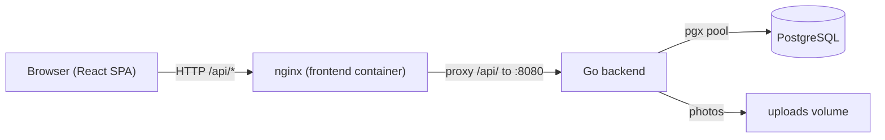

# Architecture

How the Seller Panel is built and the rules every feature follows. Business rules live in [`DOMAIN.md`](DOMAIN.md), stack choices in [`DECISIONS.md`](DECISIONS.md). Status: **draft for team review** (issue #29).

## 1. System overview



- One backend, one database, one SPA. No message queue, no cache, no microservices: the team has 3–5 days.
- The browser only talks to the SPA origin. nginx (production) and the Vite dev server proxy `/api` to the backend, so there is no CORS setup.
- The backend is a stateless Go process. All state is in PostgreSQL and the uploads volume.

## 2. Backend structure

Packages are grouped by **feature**, not by technical layer, so one person can own a feature end to end.

```
backend/
  cmd/
    server/main.go        wiring: config, db, migrations, router, graceful shutdown
    seed/main.go          dev seed (categories, demo products, ~30 orders)
  migrations/             NNNN_name.up.sql / NNNN_name.down.sql (golang-migrate)
  internal/
    config/               env loading
    platform/
      database/           pgx pool, InTx helper, migration runner
      httpx/              JSON helpers, error type, auth middleware, pagination
    auth/                 sign up, login, JWT
    shop/                 shop profile
    catalog/              categories (read only)
    product/              products, photos
    stock/                stock change, stock label; reserve / release / commit for orders (D5)
    order/                orders, status machine, simulate order
    dashboard/            summary queries
    balance/              balance entries
```

Each feature package has the same files:

| File | Responsibility |
|------|----------------|
| `handler.go` | HTTP only: parse request, call service, write response |
| `service.go` | Business rules: validation, status machine, stock, commission |
| `repository.go` | SQL only: queries and mapping, no business decisions |
| `model.go` | Types used by the feature |

### Layer rules

1. `handler` calls `service`. `service` calls `repository`. Never the other way and never skipping a layer.
2. `service` does not import `net/http`. `repository` does not know about HTTP or rules.
3. `service` declares the repository interface it needs. Tests pass a fake.
4. Features do not import each other's concrete types. If `order` needs stock operations, it declares a small interface and `stock`'s repository implements it.
5. Wiring happens only in `cmd/server/main.go`.

## 3. Database access

- Driver: **pgx** (`pgxpool`) with **hand-written SQL**. No ORM, no query generator.
- Repositories take a `DBTX` interface (satisfied by both the pool and a transaction), so the same method works inside or outside a transaction.
- `database.InTx(ctx, func(tx pgx.Tx) error)` starts a transaction, commits on `nil`, rolls back on error or panic. Services use it for anything that changes more than one row.
- IDs: `bigint generated always as identity`. Money: `bigint` in so'm. Time: `timestamptz`, stored in UTC.
- Migrations: **golang-migrate**, SQL files in `backend/migrations`, embedded into the binary and applied on backend start (guarded by an advisory lock so two instances cannot race). Never edit a migration that is merged; add a new one.

### Concurrency rules (the part reviewers will check)

- **Reserve stock** is one atomic statement that cannot oversell:
  `UPDATE products SET reserved = reserved + $qty WHERE id = $id AND shop_id = $shop AND stock - reserved >= $qty`. Zero rows updated means `insufficient_stock`.
- **Status change** locks the order row (`SELECT ... FOR UPDATE`), checks the transition table in the service, applies the side effects, and updates the status in the same transaction. Two simultaneous accepts cannot both succeed.
- Orders with several items lock and update products in ascending `id` order to avoid deadlocks.
- The database is the last line of defence: `CHECK` constraints keep `stock >= 0`, `reserved >= 0` and `reserved <= stock`, and status is an enum. A service bug fails loudly instead of corrupting data.

## 4. Auth and data isolation

- Email + password. Passwords hashed with bcrypt. Login returns a JWT (HS256, signed with `JWT_SECRET`, TTL from config) carrying `seller_id` and `shop_id`. Final wording of D2 is part of issue #10.
- An auth middleware validates the token and puts `seller_id` and `shop_id` into the request context. Handlers read them from the context, **never from the request body or URL**.
- **Every repository method takes `shopID` and includes it in the `WHERE` clause.** Asking for another seller's product or order returns `404`, same as a missing one. This is the single rule that guarantees "a seller only sees their own data" and it gets a test per feature.
- Logout is client-side (drop the token). No server session store.

## 5. API conventions

The contract is `api/openapi.yaml` (D3). These conventions apply to every endpoint:

| Topic | Rule |
|-------|------|
| Format | JSON, `snake_case` fields, money as integer so'm |
| Lists | `?page=1&page_size=20` (default 20, max 100). Response: `{ "items": [...], "page": 1, "page_size": 20, "total": 134 }` |
| Errors | `{ "error": { "code": "insufficient_stock", "message": "...", "fields": { "qty": "must be positive" } } }`, `fields` only for validation |
| `400` | Invalid input (`code: validation_failed`) |
| `401` | Missing or invalid token |
| `404` | Not found, or belongs to another shop |
| `409` | State conflict: invalid status transition, insufficient stock, duplicate SKU, email taken |
| `500` | Unexpected. Logged with details, response has no internals |
| Validation | In the service, before any SQL. The database constraints are a second check, not the first |

Photos: `POST /uploads` accepts jpeg, png or webp up to 5 MB, stores the file under `UPLOAD_DIR`, returns its URL. The product stores URLs. The backend serves the files and nginx proxies them under `/api/uploads/...`.

## 6. Cross-cutting

- **Config:** environment variables only, loaded once in `config`. Defaults make `docker compose up` work without a `.env`.
- **Logging:** `log/slog` JSON to stdout, one line per request (method, path, status, duration), no passwords or tokens.
- **Shutdown:** `http.Server.Shutdown` on SIGTERM, then close the pool.
- **Time zone:** "today", "last 7 days" and "last 30 days" on the dashboard use one fixed business time zone (see open questions).

## 7. Frontend structure

```
frontend/src/
  app/          router, providers, layout
  features/     auth, shop, products, orders, dashboard, balance (pages, components, hooks per feature)
  shared/       api client, ui components, formatting helpers
```

- React + TypeScript + Vite, React Router for routes.
- Server state with TanStack Query: each screen has loading, empty and error states (graded in `EVALUATION.md`).
- API types generated from `api/openapi.yaml`, so the client cannot drift from the contract.
- A protected-route wrapper redirects to login when there is no token. A `401` response clears the token and redirects.
- Features mirror the backend packages, so the owner of "Orders" owns `order/` and `features/orders/`.

## 8. Testing strategy

| What | How | Where |
|------|-----|-------|
| Status transitions | Table-driven unit tests over every `from → to` pair, valid and invalid | `order` service |
| Commission math | Pure function with integer arithmetic, edge cases (rounding, zero) | `balance` / `order` service |
| Stock reserve and release | Integration tests against a real PostgreSQL, including two concurrent accepts and "never negative" | `product` + `order` repository |
| Data isolation | Per feature: seller B requesting seller A's resource gets `404` | handler or integration |
| HTTP behaviour | `httptest` against the router | each `handler` |
| Frontend | A few component tests for critical flows (login, stock change, order transition) | `features/*` |

CI (`.github/workflows/ci.yml`) already runs lint, vet, build and tests. Integration tests need a database, see open questions.

## 9. Open questions for the team

Reviewers: please answer these in the PR. A recommendation is given for each.

1. **Token storage.** `localStorage` with `Authorization: Bearer` (simple, exposed to XSS) or an httpOnly cookie (safer, needs CSRF thinking). *Recommend:* Bearer + `localStorage` for this project, noted as a known trade-off.
2. **Integration test database.** GitHub Actions `services: postgres` in CI plus the compose `db` locally, or `testcontainers-go`. *Recommend:* CI service container, fewer moving parts.
3. **Business time zone** for the dashboard. *Recommend:* `Asia/Tashkent`, a constant in config.
4. **Order number.** A global sequence starting at 100000 (`#100245`) or per-shop numbering. *Recommend:* global sequence, unique and simple.
5. **Photos on disk vs object storage.** *Recommend:* local volume for the MVP, object storage is out of scope.
6. **Frontend libraries.** TanStack Query, React Router and generated OpenAPI types as above. Any objection or a UI kit the team prefers?
