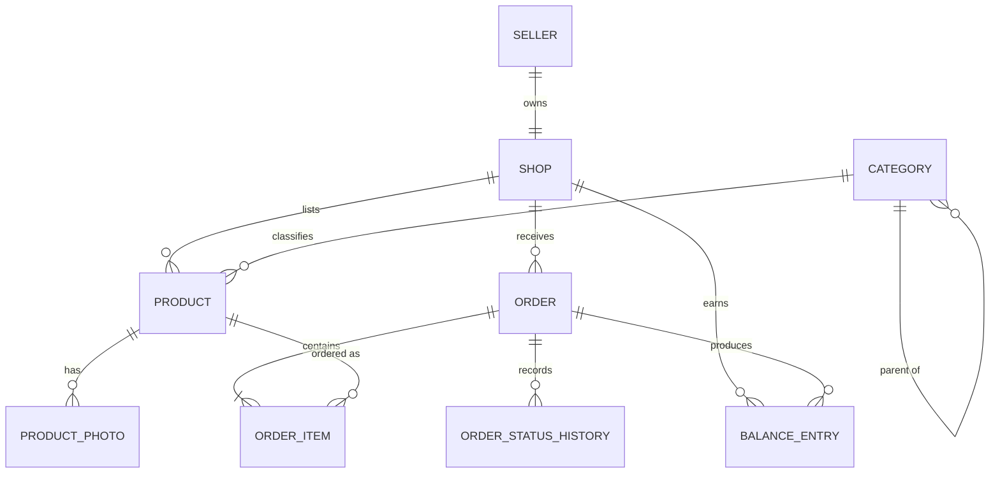
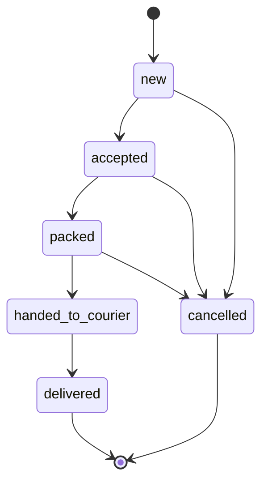

# Data model

Entities, relations and the rules that keep stock and money correct. Starts from the suggested model in [`DOMAIN.md`](DOMAIN.md); every change from it is listed in section 8. Table-level SQL is in `DB_SCHEMA.md` (issue #31). Status: **draft for team review** (issue #30).

## 1. Entity relationship diagram

Ownership rule: everything a seller can see hangs off exactly one `shop_id`. There is no buyer entity, the buyer's name, phone and address are stored on the order.

## 2. Entities

IDs are `bigint` identity. Money is an integer in so'm. Timestamps are UTC.

### Seller
| Field | Notes |
|-------|-------|
| `id` | |
| `email` | unique, stored lower-case |
| `password_hash` | bcrypt |
| `created_at` | |

### Shop (exactly one per seller)
| Field | Notes |
|-------|-------|
| `id`, `seller_id` | `seller_id` unique |
| `name` | required |
| `logo_url`, `description` | optional |
| `contact_phone`, `pickup_address` | optional until the seller fills the profile |
| `created_at` | |

An empty shop is created together with the seller at sign up, so every authenticated seller has a `shop_id`.

### Category (seeded, read only)
| Field | Notes |
|-------|-------|
| `id`, `name` | |
| `parent_id` | nullable, two levels are enough (Electronics › Phones) |

### Product
| Field | Notes |
|-------|-------|
| `id`, `shop_id`, `category_id` | |
| `title`, `description` | title required |
| `price` | integer so'm, greater than 0 |
| `sku` | unique per shop |
| `stock` | units physically owned, never negative |
| `reserved` | units promised to accepted orders, `0 <= reserved <= stock` |
| `status` | `draft`, `active`, `archived` |
| `created_at`, `updated_at` | |

Derived (not stored): `available = stock - reserved`, and the stock label:
- `out_of_stock` when `available = 0`
- `low_stock` when `0 < available <= LOW_STOCK_THRESHOLD` (config, default 5)
- `in_stock` otherwise

### ProductPhoto
| Field | Notes |
|-------|-------|
| `id`, `product_id` | |
| `url` | from `POST /uploads` |
| `position` | 0 is the cover. An active product needs at least one photo |

Photos are a table rather than an array so order and removal are simple and each photo can be referenced.

### Order
| Field | Notes |
|-------|-------|
| `id`, `shop_id` | |
| `number` | human readable, from a sequence starting at 100000, shown as `#100245`, unique |
| `status` | `new`, `accepted`, `packed`, `handed_to_courier`, `delivered`, `cancelled` |
| `buyer_name`, `buyer_phone`, `delivery_address` | copied at order time |
| `total` | sum of `price_snapshot * quantity`, fixed when the order is created |
| `cancel_reason` | required when `cancelled`, null otherwise |
| `created_at`, `status_changed_at` | |

One order belongs to one shop. A buyer who orders from two shops produces two orders.

### OrderItem
| Field | Notes |
|-------|-------|
| `id`, `order_id`, `product_id` | `product_id` is never deleted (products are archived), so the reference stays valid |
| `title_snapshot`, `price_snapshot` | copied from the product at order time |
| `quantity` | greater than 0 |

Editing or archiving a product later never changes old orders.

### OrderStatusHistory
| Field | Notes |
|-------|-------|
| `id`, `order_id` | |
| `from_status`, `to_status` | |
| `reason` | for cancellations |
| `created_at` | |

One row per transition, written in the same transaction as the status change. Powers the timeline on the order page and gives the team an audit trail. This table is an addition to `DOMAIN.md`, see section 8.

### BalanceEntry
| Field | Notes |
|-------|-------|
| `id`, `shop_id`, `order_id` | `order_id` is null for payouts |
| `type` | `sale`, `commission`, `payout` |
| `amount` | signed integer: `sale` positive, `commission` and `payout` negative |
| `created_at` | |

Entries are append only: never updated, never deleted. A corrected situation gets a new entry.

## 3. Order status machine

| From | Allowed next | Side effects (same transaction) |
|------|--------------|----------------------------------|
| `new` | `accepted` | For every item `reserved += quantity`. If any item has not enough `available`, nothing changes and the request fails with `409 insufficient_stock` |
| `new` | `cancelled` | Reason required. No stock change, nothing was reserved |
| `accepted` | `packed` | none |
| `accepted` | `cancelled` | Reason required. `reserved -= quantity` for every item |
| `packed` | `handed_to_courier` | none |
| `packed` | `cancelled` | Reason required. `reserved -= quantity` for every item |
| `handed_to_courier` | `delivered` | `stock -= quantity` and `reserved -= quantity` for every item. Add a `sale` entry (+`total`) and a `commission` entry (−commission) |
| `delivered`, `cancelled` | nothing | final states |

Every transition also updates `status_changed_at` and writes one `OrderStatusHistory` row. Any other transition is rejected by the backend with `409 invalid_transition`, regardless of what the UI shows. `handed_to_courier` cannot be cancelled: the goods have left the shop.

## 4. Stock rules

1. `available = stock - reserved` is the only number a buyer or the simulate-order endpoint may use.
2. Reserving is all or nothing per order and cannot oversell, even with two simultaneous accepts (see the concurrency rules in `ARCHITECTURE.md`).
3. Manual stock change (`PATCH /products/:id/stock`) sets the new `stock`. It must be `>= reserved`, otherwise `409` (the seller cannot take back goods already promised).
4. Archiving a product hides it from new orders but keeps its `reserved` units until those orders finish. Old orders are unaffected.
5. `stock` and `reserved` can never become negative: enforced in the service and by `CHECK` constraints.

Example: `stock 10, reserved 0`.
1. Order A (6 units) accepted: `reserved 6`, `available 4`.
2. Order B (5 units) accept: fails, `409 insufficient_stock`, nothing changes.
3. Order A cancelled: `reserved 0`, `available 10`.
4. Order B (5 units) accepted then delivered: `stock 5`, `reserved 0`.

## 5. Money, commission and balance

- Everything is an integer in so'm. No floats anywhere, including the frontend formatting layer (format only at display time).
- `commission = total * COMMISSION_PERCENT / 100` with integer division (rounds down, config default 10).
- Created once, when the order becomes `delivered`: a `sale` entry of `+total` and a `commission` entry of `-commission`. A unique rule on `(order_id, type)` makes a second delivery impossible.
- Balance = sum of `amount` over the shop's entries. Net per order = `total - commission`.
- Cancelled orders create no entries.
- `payout` exists in the model for later. The MVP never creates one.

Example: `total 250000` → commission `25000`, net `225000`. Odd amount: `total 12345` → commission `1234`, net `11111`; the two entries sum to exactly `11111`, no so'm is lost or invented.

## 6. Dashboard definitions

All dates use the business time zone from `ARCHITECTURE.md` (open question there).

| Widget | Definition |
|--------|------------|
| Today's orders | count of orders with `created_at` today |
| Waiting for action | count of orders in `new`, `accepted` or `packed` (the seller must act), shown with a count per status |
| Revenue, last 7 / 30 days | sum of `total` of orders that became `delivered` in that window (by `status_changed_at`), with the net after commission shown next to it |
| Top 5 products | by units sold in orders delivered in the last 30 days |

## 7. Seed data

- Categories: a small tree (Electronics › Phones, Clothing › Men / Women, Home › Kitchen).
- Dev seed command creates one demo seller and shop, about 15 products, and about 30 orders across all statuses over the last 30 days, with balance entries for the delivered ones.
- `POST /dev/simulate-order` (development only) creates a random `new` order from the shop's active products with `available > 0`.

## 8. Differences from `DOMAIN.md`

| Change | Why |
|--------|-----|
| `ProductPhoto` table instead of `photos[]` | order, removal and cover photo are simple |
| `OrderStatusHistory` added | order timeline in the UI and an audit trail |
| `BalanceEntry.amount` is signed, `order_id` nullable | one sum gives the balance, payouts have no order |
| Order `number` from a sequence | unique, human readable |
| `handed_to_courier` cannot be cancelled | matches the status table in `DOMAIN.md`, stated explicitly |

## 9. Open questions for the team

1. **Commission rounding.** Round down (seller keeps the extra so'm) or round half up. *Recommend:* round down, simplest and documented.
2. **Low-stock threshold.** One global value from config, or a setting per shop. *Recommend:* global config for the MVP.
3. **"Revenue" on the dashboard.** Gross (`total`) or net after commission as the headline number. *Recommend:* gross as the headline, net shown beside it.
4. **"Waiting for action"** includes `accepted` and `packed` or only `new`. *Recommend:* all three, the seller has work to do in each.
5. **Order status history table.** Keep it, or drop it to save a table. *Recommend:* keep, it is cheap and makes the order page better.
6. **Product deletion.** Archive only (as above), or also allow hard delete for products with no orders. *Recommend:* archive only.
